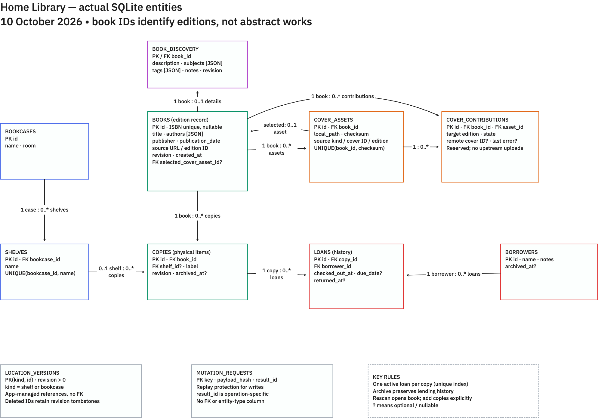
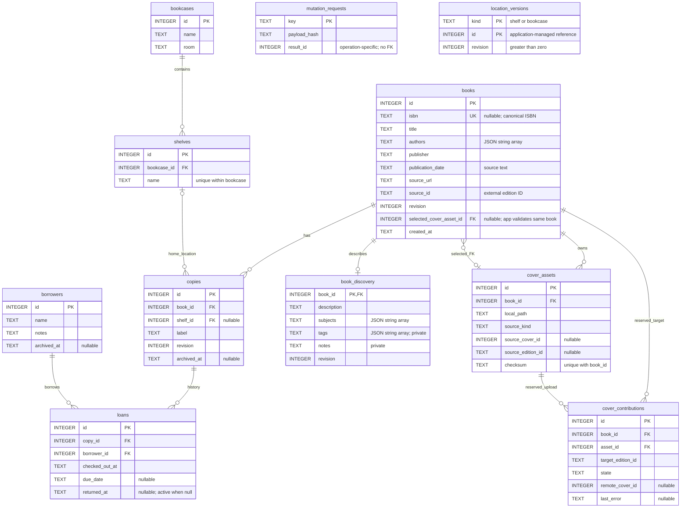

# Home Library entity relationships

Current implemented SQLite model, checked against `internal/store/schema.sql`, `discovery.go` and `locations.go` on **10 October 2026**. Proposed ebook, audiobook and abstract-work models are deliberately excluded.

`ER_DIAGRAM.mmd` is the editable Mermaid source for the diagram below.

## Read the model

A **book** is currently an edition record: one title/author/publisher/publication/ISBN combination. A **copy** is an individual physical item. For example, two copies of the same edition share one book ID, but can live on different shelves and have different loan histories. A book without an ISBN still receives its own stable ID.

One book can have many copies, cover assets and loan histories through its copies. A shelf belongs to exactly one bookcase; a copy has zero or one home shelf. The home shelf remains recorded while a copy is borrowed. Each loan records one copy and one borrower; returning it fills `returned_at` instead of deleting the row.

## Important constraints

- **Duplicate scans:** canonical ISBN uniqueness identifies the existing edition. Rescanning opens it; adding another physical copy is an explicit operation.
- **Copies and lending:** a partial unique index on `loans(copy_id)` where `returned_at IS NULL` permits only one active loan for each copy. Availability is derived from active loans and non-archived copies, rather than a separate stored status.
- **Locations:** `(bookcase_id, name)` is unique for shelves. Shelf/bookcase removal is blocked while any copy references the location, including archived copies. Location revision checks prevent stale updates.
- **Archives:** copy and borrower archive timestamps retain history. Historical loans remain linked to their original IDs.
- **Selected cover:** the nullable `books.selected_cover_asset_id` FK references an existing asset. Application code additionally verifies that the asset belongs to that same book. This ownership rule is **not** a composite SQL FK. The Mermaid `selected_FK` relationship shows the unconstrained SQL reference; application behavior selects at most one owned asset per book.
- **Discovery:** each book has at most one `book_discovery` row; its book ID is both primary key and foreign key, with cascade deletion. Subjects/tags and authors are JSON arrays stored in text columns; separate author/subject entities do not exist yet. Personal tags/notes stay out of static page snapshots.
- **Cover contributions:** the table exists as a reserved structure. The current workflow stores/chooses local covers; it does not write to Open Library or populate contribution records automatically.

## Supporting tables

`mutation_requests` protects retries: one request key and payload hash identify the recorded result. `result_id` has different meanings for different operations and has no foreign key or entity-type column. No relationship is drawn as though it always points to a book.

`location_versions` stores revisions under the composite key `(kind, id)` where kind is `shelf` or `bookcase`. These references are maintained by application transactions rather than SQL foreign keys. Deleted location IDs retain revision tombstones; they are not active shelf/bookcase records.

The metadata disk cache, immutable image files, generated static pages and external Open Library works are outside these SQLite entities. They are not database tables or owned copies.

## Editable Mermaid source

The drawing shows 11 domain/support entities. The derived `book_search` FTS5 virtual table and its SQLite shadow tables are excluded: they contain rebuildable search documents keyed by `books.id`, maintained by insert/update/delete triggers, rather than separate owned-book records.
