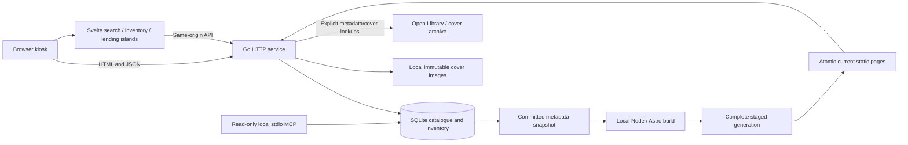
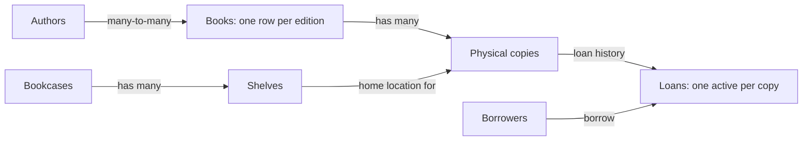
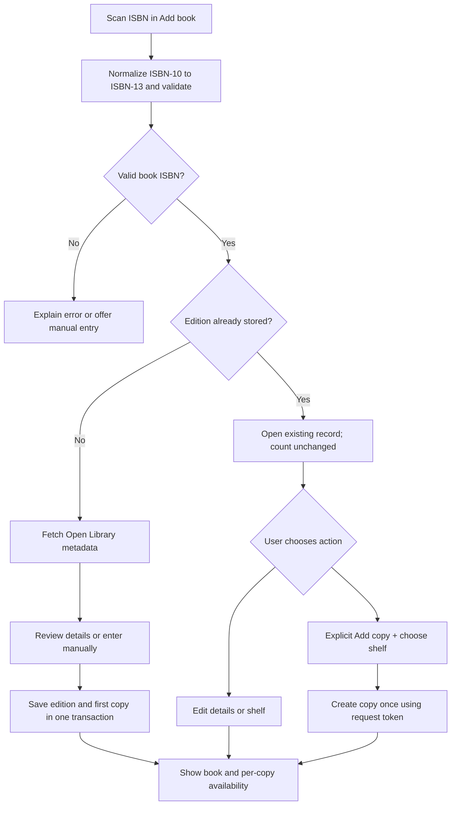

# Home library management system — plan

Date: 9 October 2026
Status: first working slice implemented; see RELEASE_ACCEPTANCE.md for outstanding acceptance criteria.

## 1. Recommendation

Build a single local Go service that serves an Astro static build and a JSON API.
Store library data in SQLite and cover images in a local directory.
Use Svelte islands for search, scanning, book details, copy locations and loans.
Build the Go executable on the development computer; ship Astro source and install its Node dependencies on the Pi for page generation.

This meets the learning goal while avoiding an Astro/Node server on the device.
The browser, application, database and cached covers all run locally. Internet
access is used only for uncached book metadata and covers.

**Confirmed choices**
- Rescanning an existing ISBN opens its record. It does not add a copy.
- Adding another physical copy is an explicit action.
- Internet access is available for book lookups.
- Lumos for Astro is the chosen styling framework.

**Initial assumptions**
- One household, one local kiosk, no public internet exposure.
- A USB scanner that behaves like a keyboard and sends Enter after a scan.
- A Pi capable of running a supported 64-bit desktop OS and a modern browser.
- Each physical copy has one home shelf. Shelves belong to bookcases.
- Due dates are optional; loan history is retained.

## 2. Architecture and deployment

| Part | Choice | Reason |
| --- | --- | --- |
| Backend | Go standard library HTTP server | Small deployment and clear request handling |
| Database | SQLite through database/sql and modernc.org/sqlite | Embedded database; no separate database service; no C compiler needed for the driver |
| Frontend | Astro static output + official Svelte integration | Static page shell with selected interactive components |
| Styling | Lumos for Astro: tokens, themes, layered CSS and components | Consistent styling across static pages and Svelte islands |
| Metadata | Open Library ISBN/edition lookup | Edition-specific title, authors, publisher, date and cover references |
| Covers | Local downloaded cache + manual upload | Existing records remain usable without internet |
| Runtime | One Go process managed by systemd | Start on boot and restart after failure |
| Display | Browser opening localhost in kiosk mode | Works with the attached screen and scanner |

Use a same-origin API: HTML, JavaScript, covers and /api/* all come from Go.
Serve generated static output from the data directory; keep database, cover assets and derived page generations separate. Ship Astro source and installed build dependencies with the Go service.
Use ordinary fetch requests. Refresh after mutations and on window focus; defer
WebSockets, service workers and background browser queues.

Suggested deployment:
- Executable: /opt/home-library/library
- Persistent data: /var/lib/home-library/library.sqlite and covers/
- Browser address: http://127.0.0.1:8080
- Default listener: loopback only.
- Dedicated unprivileged service account; data directory writable only by it.
- Build for the actual Pi OS/CPU target and test on that hardware before calling it supported.

No Docker, reverse proxy or cloud account is needed for the initial local kiosk.
Astro/Node and Lumos support page generation. Node/Astro are needed on-device to regenerate static book pages after metadata changes.
Use Lumos v0.0.5 as the initial reference (source commit
`d8591421cb2c6596fd80c9814cc31eb02e1f95ff`). Its starter requires Node
22.12.0 or newer and declares Astro ^7.3.8. Pin tested dependencies in the
frontend lockfile and verify the matching Svelte integration when scaffolding.
A future household-LAN mode should add authentication and review network access.

### Architecture diagram

The architecture diagram below is editable Mermaid source.



## 3. What “mostly static” means here

Each owned book has a stable `/books/{id}/` route generated by `src/pages/books/[id].astro`. Astro renders title, authors, publisher, publication date, selected cover and public descriptive metadata into HTML. Svelte islands load copy counts, shelf locations and lending status from Go. Editing controls, cover selection and private reading notes are also interactive islands.

Go exports a committed SQLite metadata snapshot and invokes the locally installed Astro CLI on startup and after book additions/edits or selected-cover/descriptive metadata changes. Builds are serialized and coalesced when metadata has not changed. A complete build is published through an atomic current-generation symlink; failed builds preserve previous output. Saved database records remain authoritative and publication failure is shown. A book request retries generation rather than silently serving stale metadata. Old `/book/?id=42` URLs redirect to `/books/42/`.

For this first implementation, Astro rebuilds the whole static site from the snapshot. Later optimize per-book generation if measurements justify it. Keep generated pages outside the executable in the persistent data directory, separate from database and cover assets. Node and installed Astro dependencies are required on the device to generate pages; there is still no Node HTTP server.

Changing shelves, adding copies or returning/borrowing copies does not rebuild book pages. The catalogue and discovery result lists remain live islands so new books appear immediately after save. No server islands are required.

| Route | Static HTML | Svelte islands |
| --- | --- | --- |
| / | Layout and search shell | Catalogue, search results and status |
| /scan/ | Layout and instructions | Lookup and add form |
| /books/{id}/ | Book metadata and selected cover | Inventory, lending, cover picker, editor, reading notes |
| /discover/ | Layout and instructions | Explained theme/idea search |
| /loans/ | Layout | Borrowers and active loans |
| /shelves/ | Layout | Bookcase/shelf management |
| /settings/ | Layout | Backup/export status |

Use one cohesive island per main workflow initially. A status widget for every
book card would create unnecessary fetches and coordination. Cards can be small
Svelte components inside Catalogue rather than separate Astro islands.
Lazy-load genuinely optional below-the-fold features later.

Each island needs loading, empty, error and saved states. If JavaScript fails,
the static page remains readable and tells the user the interactive area could
not load. Inventory interactions require JavaScript.

## 4. Styling and interaction

**Direction: a calm reading-room interface.** Warm background, high contrast
text, restrained forest-green actions and book covers as the main visual colour.

| Token | Initial value |
| --- | --- |
| Page background | #F6F3ED |
| Surface | #FFFFFF |
| Text | #202620 |
| Muted text | #596158 |
| Primary action | #285943 |
| Border | #D7DDD4 |
| Spacing | Lumos fluid --space-* tokens, expressed in rem |
| Body type | System sans-serif; Lumos text-main scale, tuned for kiosk readability |
| Headings | System serif |
| Controls | At least 2.75rem touch target at default font size; generous spacing |

Check contrast during implementation, including focus outlines and status labels.
Use explicit words: “Available”, “On loan to Alex”, “2 copies · 1 available”.
Colour must not be the only status cue.

Use a compact list with covers for search results and a larger cover on the
detail page. Preserve image aspect ratio; show a labelled placeholder when absent.
On wider screens, put the cover and metadata beside the copy list.
On narrow screens, stack them. Avoid elaborate animations and virtual shelves.

Primary navigation: Library · Scan book · Loans · Shelves.
Keep a visible scan input on the Scan page and keyboard focus after successful scans.
Do not capture all keystrokes globally: a scanner must not corrupt borrower-name
or search inputs. Include manual ISBN entry and clear inline feedback.

### Lumos integration

Use **Lumos for Astro**, the framework linked from lumosframework.com/docs,
not the older Lumos Webflow framework. Its source is copied into the project,
so changes remain editable and all generated assets can be served locally.

Follow its four CSS layers in order: `base, patterns, components, utilities`.
Import global.css once from the Astro base layout. Customize swatches, type and
fluid spacing in base.css; use theme-light for the initial library appearance.
Map the proposed palette into Lumos tokens, including --brand-500 and
--brand-text (white for the proposed dark green), rather than duplicating
unrelated theme variables. Preserve rem sizing and reduced-motion behaviour.

Use Lumos Section, ContentWrapper, Grid, Heading, Nav, Button and SkipLink
components for the static shell. Keep a small set of library-specific components:
StatusBadge, BookCard and CopyRow. Native controls remain the baseline.

**Svelte boundary:** Astro components cannot be imported as live Svelte controls.
Static wrappers can surround islands, but live buttons, forms and cards belong
inside Svelte. Reuse Lumos tokens/utilities and deliberately share component CSS
or make small Svelte equivalents from its accessible markup. Do not assume CSS
inside an unused Astro component is automatically present in the island.
Put library-specific rules in the components layer so utilities still override
them. Avoid unlayered Svelte styles unintentionally beating all Lumos layers.

Example: an Astro Section contains the catalogue island. Its live CopyRow uses
the same theme colours, spacing and focus styles as the surrounding navigation.
Lumos styles the interface; Go and Svelte still own inventory and loan behaviour.
No additional browser framework is introduced. Node/Astro are installed on the Pi for background static page generation; Go owns serving and persistence.

Use only required interaction scripts. Avoid giving both Lumos scripts and Svelte
ownership of the same modal or form. Keep book covers as ordinary images using
local /covers URLs; newly added covers cannot require Astro build-time processing.

### Installed project skills

All five official skills from Lumos v0.0.5 are installed in `.agents/skills/`:
- lumos-import-figma — translate a supplied design into Lumos tokens/components.
- lumos-import-webflow — migrate an existing Webflow site if ever needed.
- lumos-upgrade-version — preserve customizations when upgrading the framework.
- lumos-audit-props — check consistency in component APIs.
- lumos-scaling-graphic — build editable proportional graphics.

Source: `lumosframework/lumos-for-astro`, commit
`d8591421cb2c6596fd80c9814cc31eb02e1f95ff`. Instructions and bundled helpers were
installed; no skill helper was executed. Lumos source is installed in `web/`,
with the MIT license and source stamp retained. Library controls use its tokens
and layered CSS. Keep project skills at the repository root and the frontend in web/.
When using helpers, check paths/cwd against that layout. Record the Lumos source
stamp in the frontend package.json when scaffolding, as its upgrade workflow expects.

## 5. Data model: edition versus physical copy

A **book record** describes a particular edition. A **copy** describes one physical
item you own. Title alone is never a unique identifier.

Example: two copies of the same paperback share metadata. Copy 1 belongs on
Living room / Bookcase A / Shelf 2. Copy 2 belongs on Study / Bookcase B / Shelf 1.
If Alex borrows copy 1, the page says “2 copies · 1 available”, and retains its
home shelf for return. A hardback with another ISBN is a separate edition.

| Table | Core fields |
| --- | --- |
| books | id, canonical_isbn13 nullable UNIQUE, title, subtitle, publisher, publication_date_text, publication_year nullable, description, language, page_count, cover_path, source_id, source_url, metadata_fetched_at, timestamps |
| authors | id, display_name, normalized_search_name |
| book_authors | book_id, author_id, display_order |
| bookcases | id, name, room optional |
| shelves | id, bookcase_id, name, position |
| copies | id, book_id, home_shelf_id nullable, copy_label, notes, archived_at nullable, timestamps |
| borrowers | id, name, notes optional |
| loans | id, copy_id, borrower_id, checked_out_at, due_date nullable, returned_at nullable |
| mutation_requests | request_key UNIQUE, operation, payload_hash, committed_result, created_at |

An unset shelf appears as “Unassigned”; it is not silently guessed.
Publication dates may be just a year or free-form text. Preserve source precision;
do not invent a day and month.

Derive copy count from non-archived copies. Derive “out” from an active loan;
do not store a second availability flag that can disagree.
Retain retired-copy loan history. Prevent retiring a copy with an active loan.
Prevent deletion of referenced shelves/borrowers; offer reassignment or archiving.

Enforce foreign keys on every connection. Add a unique partial index on
loans(copy_id) WHERE returned_at IS NULL to prevent simultaneous active loans.
Use transactions for all inventory/loan changes.



## 6. Barcode scanning and duplicate prevention

An ISBN barcode identifies an edition, not an individual physical copy.

1. Read the scanner input, trim whitespace/hyphens, validate checksum.
2. Accept book ISBN-13 prefixes 978/979 and valid ISBN-10; convert ISBN-10 to its
   canonical ISBN-13. Ignore a scanner's separately configured price supplement.
   Reject unrelated EAN/UPC values with an explanation.
3. Check SQLite first using the canonical ISBN.
4. If found, open that record. The number of copies stays unchanged.
5. If new, request metadata through Go, review/edit it and select a shelf.
6. Save the edition and its first copy atomically.
7. Offer “Add another copy” explicitly on the existing record.

A scan is a lookup, not an inventory mutation. Repeating it is harmless.
“Updated” means edits save to the existing record rather than creating another
book row. Scanning does not overwrite metadata or increment counts.

Protect at multiple levels:
- Database UNIQUE constraint on canonical ISBN, not just a frontend check.
- Transactional get-or-create; if another request won the insert, return that
  existing record without silently adding a first copy.
- Fresh request token for each deliberate Add copy/checkout/save action.
  Retrying the same token returns its committed result; altered payload is rejected.
- Disable repeated submission while pending, but treat this as convenience only.
- ISBN-10 and matching ISBN-13 resolve to the same row.
- Do not deduplicate by title/author: different editions are legitimate records.

Books with no ISBN use manual entry and an internal id. Show possible matches
for review; never merge them automatically. Changing a book's ISBN to one
already present raises a conflict; merging is a later explicit workflow.



## 7. Lookup, covers and offline behaviour

Use Open Library's ISBN/edition endpoint for an exact edition. Its work-level
first publication year is not necessarily this edition's publication date.
Resolve authors and cover references in Go and present a review form.

- Use cached records first; identify the client and respect provider limits.
- Bound request time, size and retries; normal use performs lookups as needed.
- Missing metadata, timeout or no match leads to manual entry.
- Store accepted metadata, source link and fetch time in SQLite.
- Cache a modest-size cover locally; use the Covers API's default=false option
  to detect absent images. Provide a manual cover-upload option.
- Cover failure must not stop saving a book.
- Mark pending lookups/covers and offer retry when online.
- Refresh metadata only on explicit request. Show a preview and preserve local edits.
- Do not bulk-crawl covers. Include a courtesy Open Library link.
- Fetch covers only from approved provider hosts; validate file type/size,
  generate local filenames and store files outside the embedded frontend.

The catalogue, search, shelf changes, checkout and return work without internet.
A new uncached ISBN can be saved manually and enriched later.
Browser assets and fonts are local; no CDN scripts or web fonts.

### Cover selection and correction

Treat the first fetched cover as a suggestion, not a verified match.
During import and on Book detail, provide **Change cover** with three options:
choose an alternative, upload a photo/image, or use a placeholder.

1. Resolve the exact Open Library edition (OL…M) for the ISBN.
2. Read its cover IDs and show a bounded gallery, deduplicated by cover ID.
3. Offer an explicit “Other editions” section from the related work, paginated
   on demand. Label each with ISBN, publisher, date, format and language where known.
4. Preview the chosen cover next to this book's metadata before saving.
5. Save the selection locally, cache it by cover ID and preserve it on metadata refresh.

Choosing a different edition's artwork locally does not change this book's ISBN
or metadata, and does not establish that the artwork is correct for publication
upstream. Do not silently prefer the work-level default cover.

A local upload accepts JPEG, PNG or WebP, with an implemented 8 MiB maximum and a
pixel-count limit. Decode/validate server-side, apply orientation, strip metadata,
and generate display/thumbnail variants. Give immediate preview and an option
to undo by selecting the previous cover. Replace files atomically; retain the
previous asset until the new selection commits. Do not use original filenames
as filesystem paths. Cover replacement never creates another book or copy.

Use Lumos-styled Svelte controls for the gallery and preview. Label the current
selection and its source. Announce save/error states and support keyboard use.

**Schema additions**
- books: selected_cover_asset_id nullable; openlibrary_edition_id and work_id
  nullable; keep these distinct from the local book id.
- cover_assets: id, book_id, local_path, thumbnail_path, source_kind
  (openlibrary/upload), source_cover_id nullable, source_edition_id nullable,
  checksum, dimensions, created_at. Unique source/checksum rules avoid repeats.
- cover_contributions: id, book_id, asset_id, target_edition_id, request_key,
  state, remote_cover_id nullable, last_error, attempted_at, verified_at.
- Treat the earlier books.cover_path field as a derived API value from the selected
  asset, rather than a second independently editable source of truth.

### Contributing a cover to Open Library

Add **Contribute to Open Library** as a separate action after the local upload.
Local saving must succeed independently of any remote contribution.
The review screen shows the image, exact destination edition, ISBN/publisher/date,
account identity and the public nature of the change. Require an explicit submit
for that image and destination; local upload never publishes automatically.

Open Library's help documents edition cover uploads and managing primary covers.
Its public Covers API documents retrieval. The upstream source contains
POST /books/{OL…M}/add-cover (multipart file or URL), and a separate manage-covers
route. These are website implementation routes, not a verified stable public
write API. Direct coverstore upload alone is not enough to attach an image to
an edition. The add-cover implementation prepends the new image to the edition's
cover list, so the UI must explain it can become the primary public cover.

**Implementation requirement:** investigate and test an authenticated Go adapter
for the edition upload route before enabling direct submission. Verify session
handling, account permissions, current request fields and any CSRF requirements.
Do not assume an API key or OAuth exists. Keep secrets/session material server-side,
restricted and out of logs, exports and backups. Do not ask for credentials until
implementing account connection. The provider's current source and help disagree
on upload size (10 MiB versus 30 MB); keep our 8 MiB local limit and recheck live
requirements during integration.

Until direct integration is proven compatible, provide “Open edition upload page”
and a downloadable sanitized cover, allowing the user to upload through Open
Library's normal account UI. Mark this as a manual handoff, not API success.

A direct contribution must target a verified edition match, not a guessed work.
Follow Open Library's cover guidance: a personal preference for different artwork
is not itself grounds to replace an accurate community cover. Add suitable
alternatives without deleting existing images; no automated primary-cover
reordering or public cover deletion is in scope.

Track draft / submitting / verified / failed / outcome unknown states. Re-fetch
edition metadata after submission and verify the new cover association before
reporting success. Store the returned/discovered cover ID and edition link.
On timeout or an ambiguous response, reconcile the remote record before retrying;
a local request key cannot force the remote website to be idempotent.
If verification is still inconclusive, show “Check on Open Library” instead of
blindly retrying. Remote failure never rolls back the chosen local cover.

## 8. Search and lending

Search your own SQLite catalogue by title, author or ISBN. Provider searches are
only for importing missing metadata, not for ordinary library search.

Start with parameterized queries over normalized Unicode search fields, escaping
LIKE wildcards. Combine author joins with pagination and a bounded result count.
Sort predictably by title; filter by shelf and availability.
Simple substring search is sufficient initially. Add SQLite FTS5 only if actual
catalogue size or relevance needs justify it.

**Checkout**
1. Open a book and select an available physical copy.
2. Select/create a borrower; optionally set a due date.
3. Insert the loan in a transaction. Reject a copy already out.
4. Return updated copy state and counts; show who borrowed it and when.

**Return**
1. Open the active loan and select Return.
2. Set returned_at once; repeat requests return the same completed state.
3. Show its home shelf; offer a separate shelf change if it will live elsewhere.

When several identical copies exist, show copy labels and ask which one.
Optional printed internal copy barcodes can remove this ambiguity in a later
release. Scanning a publisher ISBN alone cannot identify which copy was returned.

## 9. API sketch and project layout

| Endpoint | Purpose |
| --- | --- |
| GET /api/books?q=&author=&shelf_id=&availability=&page= | Local catalogue search |
| GET /api/books/{id} | Metadata, copies, home shelves and active loans |
| GET /api/isbn/{isbn} | Resolve local record or external review draft; no inventory write |
| POST /api/books | Save reviewed new edition + first copy with request key |
| PATCH /api/books/{id} | Edit metadata with revision check |
| POST /api/books/{id}/copies | Explicitly add copy with shelf + request key |
| PATCH /api/copies/{id} | Change shelf/notes or archive with revision check |
| GET/POST /api/bookcases and /api/shelves | List/create locations |
| PATCH /api/bookcases/{id} and /api/shelves/{id} | Rename/edit locations |
| GET/POST /api/borrowers | List/create borrowers |
| GET/POST /api/loans | List loans / checkout |
| POST /api/loans/{id}/return | Return copy |
| GET /api/books/{id}/cover-candidates | Exact-edition covers; other editions only on request |
| POST /api/books/{id}/cover | Upload and select a local replacement cover |
| PATCH /api/books/{id}/cover | Select an existing cover asset with revision check |
| POST /api/books/{id}/cover-contributions | Explicit remote contribution; enabled only after adapter validation |
| GET /api/cover-contributions/{id} | Read contribution/verification status |
| GET /healthz | Service readiness |

This is a proposed contract, not a complete OpenAPI specification.
Use structured errors, bounded inputs and server-side validation. Return conflict
responses for stale revisions, duplicate ISBN edits and unavailable copies.
Accept JSON for mutations and enforce same-origin/Host checks, even on loopback.

Suggested layout:
```text
cmd/library/           startup and configuration
internal/http/         API handlers and embedded asset serving
internal/library/      book, copy and loan rules
internal/store/        SQL queries and migrations
internal/metadata/     Open Library client and normalization
web/                   Astro pages, Svelte components, CSS
migrations/            versioned SQLite schema changes
docs/                  later decisions and operational notes
```

Keep SQL explicit; defer an ORM. Embed migrations and release frontend assets.
Route /api/* before static files. Unknown API paths return JSON errors, never an
HTML fallback. Mutable API responses should not use long-lived browser caches;
fingerprinted static assets can.

## 10. Reliability and backups

Start with one database connection, foreign keys, busy timeout and WAL mode.
This serializes a small household workload while keeping database operations
simple. Do not hold transactions open during external HTTP calls.
Use durable synchronous settings rather than trading safety for small speed gains.

Back up SQLite with its online backup mechanism or VACUUM INTO, together with
cover files and a manifest. Do not copy only the live database file in WAL mode.
Keep a routine backup outside the device; an extra copy on the same SD card
does not protect against card failure. Include an export path for CSV/JSON.

Apply migrations before accepting requests; create a backup before schema-changing
upgrades. Keep backups in an OS-scheduled task rather than relying on the browser.
Verify a restore into a clean data directory before the first usable release.

The Pi must run a desktop/browser environment, which may use more resources than
the Go service. Hardware suitability is unverified until tested on the chosen Pi.
Keep pages paginated and cover images small. Confirm kiosk startup, scanner focus,
reboot recovery and operation after network disconnection on the actual device.

## 11. Delivery sequence and acceptance checks

### Phase 1 — local vertical slice
Go server, SQLite migrations, Lumos-styled Astro shell, Svelte catalogue and book detail.
Manual books, copies, bookcases and shelves. Learn static HTML versus hydration.

### Phase 2 — scanning and enrichment
USB scanner/manual ISBN, checksum validation, canonical identity, Open Library
review, alternative-cover gallery, local image uploads and duplicate-safe
first-copy/add-copy actions. Include Open Library website contribution handoff.
Validate and add direct authenticated contribution as a separate integration task;
keep its release status explicit until verified.

### Phase 3 — loans
Borrowers, checkout, return, active-loan constraints, copy labels and history.

### Phase 4 — Pi release
Embedded frontend build, service startup, browser kiosk, export/backup/restore,
hardware checks and fully offline use of saved records.

Before calling the first release complete, verify:
- The same ISBN scanned repeatedly leaves one edition and an unchanged copy count.
- Equivalent ISBN-10/13 inputs resolve to that same edition.
- A deliberate second copy gives two copies and can have a different home shelf.
- Retrying Add copy or initial save with the same request key creates nothing extra.
- Concurrent attempts to create an edition cannot bypass its uniqueness constraint.
- One copy can be lent while another remains available.
- Concurrent checkout attempts cannot create two active loans for one copy.
- Returning twice is safe; returning restores availability and preserves history.
- Author/title search, shelf filters and metadata edits persist after restart.
- Invalid/non-book codes, missing covers and provider failure give usable feedback.
- Cover choices display edition context; alternatives and local uploads persist
  after metadata refresh, restart and offline use.
- Replacing a cover changes neither book identity nor copy count.
- Invalid, oversized and excessive-dimension images fail without losing the old cover.
- Local cover upload never sends an image to Open Library automatically.
- Direct contribution, if enabled, verifies destination/account and remote cover
  association; ambiguous outcomes do not trigger duplicate uploads.
- Website handoff is clearly labelled and never reported as a completed API upload.
- Offline local operations work; manual import remains possible.
- A backup restores books, shelves, loans and cover files.
- A new book generates its static ID page automatically; shelf and lending changes require no Astro rebuild.
- Lumos styles match across the Astro shell and Svelte controls, with visible focus,
  readable contrast and usable layouts at increased browser font size.
- On the actual Pi, screen/keyboard navigation, scanner input and reboot startup work.

Defer reservations, reminder messages, accounts, public hosting, camera scanning,
recommendations, ebook management and complex work/edition merging.

## 12. Decisions to confirm during implementation

These do not block the architecture:
- Exact Pi model, RAM, OS and screen resolution.
- Scanner model and its output/supplement configuration.
- Preferred shelf labels (for example “Study / Left bookcase / Shelf 3”).
- Whether due dates are normally useful.
- Whether access from other household devices is needed later.
- Final styling after a browser mockup and screen contrast check.

## 13. Source references

Technical choices were checked against primary documentation:
- [Lumos introduction](https://lumosframework.com/docs/) — Astro-native components, themes and tokens.
- [Lumos installation](https://lumosframework.com/docs/installation/) — starter and runtime requirements.
- [Lumos cascade](https://lumosframework.com/docs/concepts/the-cascade/) — four CSS layers.
- [Lumos agent skills](https://lumosframework.com/docs/guides/agent-skills/) — official bundled workflows.
- [Lumos v0.0.5 source](https://github.com/lumosframework/lumos-for-astro/tree/v0.0.5) — inspected source and installed skills.
- [Astro islands](https://docs.astro.build/en/concepts/islands/) — static components and explicit client hydration.
- [Astro Svelte integration](https://docs.astro.build/en/guides/integrations-guide/svelte/) — Svelte support.
- [Astro server islands](https://docs.astro.build/en/guides/server-islands/) — separate runtime-rendered mechanism.
- [Go SQLite driver](https://pkg.go.dev/modernc.org/sqlite) — pure-Go driver; pin a tested version during implementation.
- [SQLite WAL](https://www.sqlite.org/wal.html) — database operation and backup considerations.
- [SQLite partial indexes](https://www.sqlite.org/partialindex.html) — enforcing one active loan per copy.
- [Open Library Books/ISBN API](https://openlibrary.org/dev/docs/api/books) — editions and exact ISBN lookup.
- [Open Library Covers API](https://openlibrary.org/dev/docs/api/covers) — cover access, missing-image behaviour and usage guidance.
- [Open Library editing help](https://openlibrary.org/help/faq/editing) — edition cover uploads and contribution guidance.
- [Open Library edition cover handlers](https://github.com/internetarchive/openlibrary/blob/master/openlibrary/plugins/upstream/covers.py) — implementation routes; not a stable write-API guarantee.


## Kiosk design principles

13 October direction: a light header, prominent focused scanner, generous cover space, and persistent task navigation. Library, Loans & returns and Add book are always available; More contains discovery and management tools. Shelf and availability filters remain under Filters. Book pages show shelf and lending/return controls together beside the cover, using live Svelte state.

Following the score plateau, compare complete kiosk compositions: scan-first desk, cover-first gallery, split catalogue/lending workspace and a circulation bar below the covers. The split preview now includes live Svelte lending/return controls; selecting or scanning a book remains read-only. Choose a coherent direction before integrating it into the default catalogue; keep independent screenshot review separate from task/focus/data-integrity acceptance. The user approved including the kiosk brief in the fixed critic prompt on13October, while preserving blindness to code, history and target scores.

- Minimize the clicks needed to finish a task. Show the next useful action immediately, carry forward entered data, and avoid intermediate result screens when the destination is clear.
- Keep scanning central: focus the ISBN field on page load and let Enter submit. A known ISBN opens its existing book directly; an unknown ISBN opens the add form and fetches details automatically.
- Require a deliberate save before adding a new book, and an explicit Add copy action before increasing inventory. Fast navigation must preserve accurate records.
- Keep uncommon filters under Advanced search, with an active-filter indicator. Title and author queries continue to search the local catalogue.
- When details cannot be fetched, keep the scanned ISBN and show manual entry immediately. Never make the user scan or type it again.
- Evaluate each workflow by the actions required to complete it, rather than the number of screens implemented.

## Future-facing services and overnight scope

SQLite is the authoritative catalogue/inventory. Shared Go services support both browser APIs and a separate read-only local stdio MCP process. MCP initially offers owned-book search, book details and shelf listing; no write tools or external suggestions.

Theme discovery starts with explained local keyword matching across titles, authors, subjects, descriptions, personal tags and notes. User edits remain local. Optional Open Library enrichment fills blank description/subjects without overwriting private notes. Semantic embeddings and model-based recommendations remain future work pending Raspberry Pi resource measurements.

Priority overnight: locally cached real covers on existing/new books, exact-edition alternatives and image uploads, static metadata pages with live inventory islands, read-only MCP and useful theme search. Cover uploads update the local record; upstream contributions remain explicit future work.


## Implementation checkpoint — 10 October 2026

Static ID pages and atomic regeneration are running, with live shelf/copy/loan islands. Four of five existing books have local provider covers; Obvious Adams awaits a user-supplied photo. Cover galleries, other-edition artwork, local upload preview and safe camera-image normalization are implemented. Borrowers, checkout/return/history and the Loans page are working. Read-only MCP and explained keyword discovery are implemented; semantic search remains future work. Optional enrichment preserves local edits. Backup CLI provides a consistent SQLite snapshot, JSON export, cover checksums and clean-directory restore.

NEA-23, NEA-26–27, NEA-31–38 and NEA-47–49 are Done. Indexed full-text search, backup activation/health controls and Pi hardware acceptance remain open. See RELEASE_ACCEPTANCE.md for tests and current limitations.


### Follow-up checkpoint — 08:06 on 10 October

NEA-35 now provides exact-edition review and a sanitized download for manual Open Library contribution. NEA-38 now includes explicit copy archival, an active-loan guard and retained history. Both are Done after browser/API/concurrency tests. Static publication preserves fingerprinted assets for older pages and retains current plus two predecessor generations with a one-hour grace period. The shared asset cache has no eviction policy yet. All real books and copy counts are preserved.

Pi build/systemd/kiosk templates and installation instructions are prepared in PI_README.md. ARM64 cross-compilation and template checks pass; NEA-39/41 remain In Progress pending hardware validation. MULTIFORMAT_PLAN.md describes proposed work/edition/holding changes for ebooks and audio; no migration has been applied. The temporary network preview expired as agreed; its separately authorized development firewall exception has a backlog review in NEA-50.


## 10 October daytime implementation checkpoint

Catalogue search now filters and paginates inside SQLite before loading a page of records. It retains literal Unicode-normalized substring matching; an FTS5 trigram index now narrows eligible queries while literal verification and short-query fallback preserve existing behavior.

Book metadata refresh prepares a provider draft for review and explicit saving. A persistent, bounded cache records fetch times, uses canonical ISBN keys, and provides dated offline fallback. It never changes copies, shelving or selected covers.

Cover assets expose provenance and dimensions. Catalogue cards and the cover picker use locally derived 320-pixel thumbnails with checksum validation, immutable caching and original-image fallback. Original files remain the backup authority; derived variants can be recreated.

Shelf and bookcase management supports stable-ID renaming and guarded removal. Durable location revisions must reject stale screens even after names change back or deleted numeric IDs are reused. The additive revision ledger is included in SQLite backups.

The multi-format model in MULTIFORMAT_PLAN.md remains a proposal. No work/edition/holding migration or digital reader/player is part of this checkpoint.

Current entity relationships are documented in ER_DIAGRAM.md and ER_DIAGRAM.mmd. The diagram reflects the implemented 11-entity domain/support model, with reserved contribution storage labelled.

## Foundation implementation — 10 October, afternoon

Catalogue title/author/ISBN search now uses SQLite FTS5 trigram candidates with literal Unicode-normalized verification and SQL pagination. Short, NUL and unsupported queries fall back safely. Insert/edit/delete triggers maintain the derived index; startup backfills missing indexes and JSON export excludes derived/shadow tables. A 5,000-book development-Mac selective-query benchmark improved from about 6.18ms to 1.29ms; Raspberry Pi performance remains unverified. Theme discovery still uses explained local keyword matches.

Startup validates recognized core versions, required keys/constraints and foreign-key integrity before atomic additive migration. Failed migration tests verify rollback; unknown/newer schemas are refused. Manual entry retains drafts across scanner navigation, presents advisory local matches, and preserves one save identity through uncertain retries. Saved-but-unpublished records have a receipt/recovery link, preventing a repeated new-book save. Edited provider provenance is reviewed; ISBN changes invalidate old provenance.

Physical scanner, physical mobile-menu keyboard acceptance, backup destination/activation and Pi installation remain release checks. Multi-format storage remains a proposal.

## Backup health and release preparation — 10 October

Settings now shows read-only saved-backup verification, freshness and safe failure states through a Svelte island. Monitoring uses an optional startup-configured destination; it remains unconfigured until a durable disk is selected. Bounded verification checks checksums, SQLite and covers, caches results briefly and warns if the newest saved attempt fails even when an earlier snapshot is sound. It does not start backups, restore, monitor every scheduler outcome or enable a timer. Durable destination selection, timer activation and Pi recovery remain acceptance work.

A source-only package builder now includes allowed source/assets/locked manifests/deployment files with checksums and safe reproducible archive paths. Tests exclude household data, environment/key files, dependencies and generated outputs; reject symlinks, unsafe destinations and overwrites. Extracted source builds Go commands for Linux ARM64 and Astro static pages using verified development dependencies. These are packaging checks; Pi dependency installation, performance, service/desktop and scanner checks remain outstanding.

## Correctness acceptance — 10 October, evening

Enrichment now guards both book and discovery revisions atomically, so a concurrent ISBN edit rejects stale provider details. Linked-work lookups run only for locally empty fields that the edition did not supply; existing local fields cannot force an unnecessary failed fallback. Personal notes/tags stay excluded from static snapshots. Fetch timestamps currently live in the persistent provider cache; storing accepted-lookup timestamps directly on books remains an unapplied model proposal.

Backup CLI/dashboard verification now checks foreign-key integrity as well as checksums and SQLite integrity; hash-valid snapshots with broken relationships are refused before restore. Startup recognizes the complete expected search trigger definitions and repairs/backfills earlier trigger variants. Old read-only MCP databases receive actionable shelf-initialization guidance without migration.

Page generation is detached from browser disconnection but bound to the service lifetime. Shutdown cancels the active Astro process, refuses canceled output and removes its staging generation. Unit regression fixtures preserve the prior generation and committed record; an isolated real startup/SIGTERM check confirmed child termination and stage cleanup. Complete race/vet and Astro checks/build passed; household domain tables remained unchanged after deployment. Residual receipt focus/duplicate suppression and Settings empty-folder/request-error/retry browser checks passed. Physical scanner, physical Menu Enter and Pi hardware remain acceptance items.

## Offline release acceptance — 21:48 Europe/London, 10 October 2026

The disposable offline acceptance runner passed against the actual built server with an owned deny proxy and observed failed Open Library request. Manual/year-only entry, local cover upload, metadata/static regeneration, repeated ISBN opening, explicit copies, shelf/checkout/return, author search, private-note exclusion, consistent live backup/verify/clean restore and offline restart passed. Fixtures/processes were removed. Source-package acceptance passed with the runner and release checklists included. This simulates provider failure, not physical network isolation or browser hydration. Scanner, Pi and durable storage acceptance remain open; NEA-43 is In Progress. See OFFLINE_ACCEPTANCE.md and RELEASE_ACCEPTANCE.md.

## Morning closure — 09:27 Europe/London, 11 October

The morning cutoff passed between heartbeat executions; no new implementation work started afterward. Overnight automation is confirmed PAUSED. Final local health endpoint returned ready; PID31430 remains listening on loopback8080. Household data was not changed at closure. MORNING_HANDOVER.md now consolidates verified results and scanner/Pi/durable-storage gaps. Last full catalogue verification remains the 10 October checkpoint; no fresh full catalogue claim is made. NEA-24/30/39–41/43 remain In Progress.
