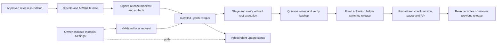

# Remote application updates and scanning backlog

14 October 2026. Proposed design, not an installed updater.

The owner should be able to open **Settings > Updates** on the Mac or iPad,
choose an approved release, and install it without an interactive Pi login,
`sudo`, or an operating-system password. The current installation needs one
privileged setup step to establish that capability. Afterward, the installed
update service performs the narrowly permitted administration itself.

## Feedback recorded in Linear

| Issue | Outcome |
| --- | --- |
| [NEA-51](https://linear.app/nealle-page/issue/NEA-51) | Choose a persistent default shelf; override it for an individual new book. |
| [NEA-52](https://linear.app/nealle-page/issue/NEA-52) | Return saves a reviewed book form reliably; barcode Return remains lookup. |
| [NEA-53](https://linear.app/nealle-page/issue/NEA-53) | Measure and reduce save latency on the actual Pi. |
| [NEA-54](https://linear.app/nealle-page/issue/NEA-54) | Implement owner-triggered, verified remote updates with recovery. |
| [NEA-55](https://linear.app/nealle-page/issue/NEA-55) | Successful shelf changes return focus to Scan next ISBN. |

All are Backlog items. No feature has been deployed by this planning work.
Suggested delivery order: capture save timings; establish and rehearse the
update mechanism; ship default shelf, Return and focus improvements through
it; then optimize the measured save bottleneck. No delivery dates are assumed.

## Current constraints and findings

- The device identifies as a Raspberry Pi 3 Model B+ with approximately 1 GB
  RAM, running 64-bit Debian/Raspberry Pi OS 13. Build work should happen off
  the Pi where practical. The initial empty-catalogue page build took about
  29 seconds; that observation does not establish book-save latency.
- Go owns SQLite and serves Astro output. Node, Astro source and platform-
  matching installed dependencies remain necessary for metadata page builds.
- The application runs under `home-library` and listens on loopback. Caddy
  provides the authenticated HTTPS household-network gateway.
- The application currently owns its source directory, and the server builds
  from that directory. Safe updates need a separate, protected release store
  and explicitly writable runtime caches.
- The repository required authentication during deployment. Recheck visibility
  before choosing download credentials; do not assume anonymous access works.
- `internal/httpapi/server.go` commits a book before `publish()` synchronously
  attempts missing-cover fetching and `Pages.Ensure()`. Cover fetching has a
  30-second bound; publication may rebuild the full static site. These are
  hypotheses for the slow-save report to measure, not an established diagnosis.

## Proposed flow

### 1. Build a release away from the Pi

Use a manually triggered GitHub Actions release workflow against an approved
commit/tag. It runs Go/frontend checks and secret scans, then produces Linux
ARM64 binaries and a dependency bundle matching the Pi's OS/libc. Use an ARM64
runner or a tested emulated ARM64 build environment; never package the Mac's
`node_modules`. Include a pinned Node runtime when required by the release.

Publish a signed manifest describing version, commit, architecture, runtime
versions, supported database versions, file hashes and migration/rollback
compatibility. A checksum identifies bytes; the signature authenticates the
approved publisher. Provision a verification public key on the Pi once. Keep
the signing private key in the release system's protected secret storage.
Pin workflow dependencies and do not sign untrusted pull-request builds.

### 2. Trigger from Settings

Show installed version, available approved release and release notes. **Install
update** creates one idempotent job for that release. A versioned, signed release
must exist before a button can install it; an ordinary push does not update the
Pi automatically.

The existing `nealle` login is the initial owner. If household accounts are
introduced, restrict update actions to the owner. Preserve same-origin checks
and use POST for changes. Accept no command, download URL, filesystem path or
service name from a browser request. Reject concurrent installation requests
and return the existing job for repeated clicks.

Proposed API: GET available releases/status and POST install with an approved
release ID plus request key. UI states: checking, downloading, verifying,
preparing, backing up, restarting, ready, recovered or needs attention.

### 3. Separate the worker from the application

During one-time setup, install a root-owned fixed update service and a tightly
scoped activation helper. A `systemd.path` unit can watch the application's
request inbox and launch the fixed worker. Treat inbox contents as untrusted:
consume requests into an owned spool, validate bounded fields, serialize jobs,
and persist state so file-watch retriggers cannot create an installation loop.

Download and prepare artifacts under an unprivileged update account. The
activation helper independently verifies the staged content and release
identity before switching the fixed application path and restarting only
`home-library.service`. Do not run release-supplied scripts, npm lifecycle
commands or migration programs as root. Do not grant blanket passwordless sudo
or access to the systemd management API to the application account.

Expose sanitized job status through the HTTPS gateway independently of the
application process, so the browser can track progress while the app restarts.
An owner-authenticated, read-only status route can serve a worker-owned status
document; application code must not be able to forge the worker's result.

### 4. Protect data and activation

Target layout: protected version directories under `/opt/home-library/releases/`
with an atomically replaced `current` link. Preserve the catalogue, covers,
generated pages and backups under `/var/lib/home-library/`. Keep the gateway's
login, TLS authority, download credentials and updater keys outside releases.

Before activation:

1. Verify signature, every file hash, ARM64/runtime compatibility, expected
   archive paths and available disk space for staging, backup and rollback.
   Reject traversal, hard links, unexpected files and links outside the release;
   allow only declared contained relative links needed by dependency bundles.
2. Validate the candidate against isolated disposable data without permissions
   to modify the live catalogue. Serialize memory-heavy work on the Pi 3.
3. Enter maintenance mode, reject new mutations clearly, and drain in-flight
   saves and publication jobs. Apply the barrier to background mutations too.
4. Create and verify a consistent SQLite-plus-covers backup using the existing
   backup utility. An on-card pre-update snapshot protects against update
   mistakes; it does not replace a backup on another device.
5. Stop the old app, atomically activate the candidate, and run schema migration
   only as the application account. Keep writes barred until validation finishes.
6. Confirm expected version, supported schema, readiness, generated pages and
   representative read APIs. Record outcome durably before resuming writes.

Astro/Vite and generated-type cache locations must be redirected to writable
state before releases can become read-only. Prototype that against the real
CLI early; unexplained source-tree writes are a release blocker, not a reason
to give the application ownership of the updater or activation path.

### 5. Recover without losing later work

Keep the previous verified release and a durable activation journal. A failed
download or verification leaves the current app running. If candidate startup
fails and its database is compatible with the previous binary, restore the
previous code and rebuild derived pages from current data.

If migration makes the database incompatible, keep maintenance mode and use
the rehearsed migration-recovery path. Do not silently restore an older
catalogue over later accepted writes. Decide and test the data-restore policy
before enabling migration-bearing releases; the first updater version should
support only database-compatible releases. Destructive/incompatible migrations
remain a separate recovery-reviewed operation.

After power loss, the worker reconciles the activation journal and resumes or
recovers before writes become available. A single instance lock prevents two
workers or simultaneous clicks from switching releases independently.

## Credentials and scope

If the repository remains private, the worker needs a repository-scoped,
read-only credential for release metadata/assets. Keep it on the Pi in restricted
service configuration and redact it from logs. The browser never receives it.
Public releases can be downloaded without that credential, but still require
publisher signature verification.

Supported application and bundled runtime releases use the remote update path.
OS upgrades, gateway/privilege changes and signing-key rotation remain separate
administration tasks. Those changes must not be disguised as routine app updates.

## Implementation stages and acceptance

1. **Version and measurements:** add an installed-version endpoint and save-stage
   timings without logging titles, borrowers, notes or passwords.
2. **Release bundle:** prove a CI-built ARM64 bundle regenerates pages on the Pi
   with protected code and separate caches. Define schema compatibility.
3. **Worker and recovery:** test signed staging, consistent backups, activation,
   compatible rollback and power-loss recovery using disposable data.
4. **Settings UI:** add owner-only check/install/progress and human-readable
   failure/recovery information; no shell commands in the product flow.
5. **One-time bootstrap and rehearsal:** install the worker permissions once;
   perform an update and rollback from the iPad without SSH or an OS prompt.

Acceptance also covers duplicate clicks, offline GitHub and expired download access.
It must safely handle corrupt or unsigned releases, wrong architecture, low disk
space, interrupted download and restart, slower-than-expected startup, failed
migrations, and preservation of shelves, copies, borrowers and loans. Reopening the
browser must show the correct job and installed version after restart.

Revisit packaging and page-generation architecture if catalogue size or Pi
memory makes staging/build times unacceptable. Keep this first design scoped
to one household Pi rather than introducing fleet management.

## Sources

- [GitHub: manually running a workflow](https://docs.github.com/en/actions/how-tos/manage-workflow-runs/manually-run-a-workflow)
- [systemd: path-unit specification](https://github.com/systemd/systemd/blob/main/man/systemd.path.xml)
- Current source: `internal/httpapi/server.go`, `internal/bookpages/generator.go`,
  `internal/store/migrations.go`, and `deploy/home-library.service`.
